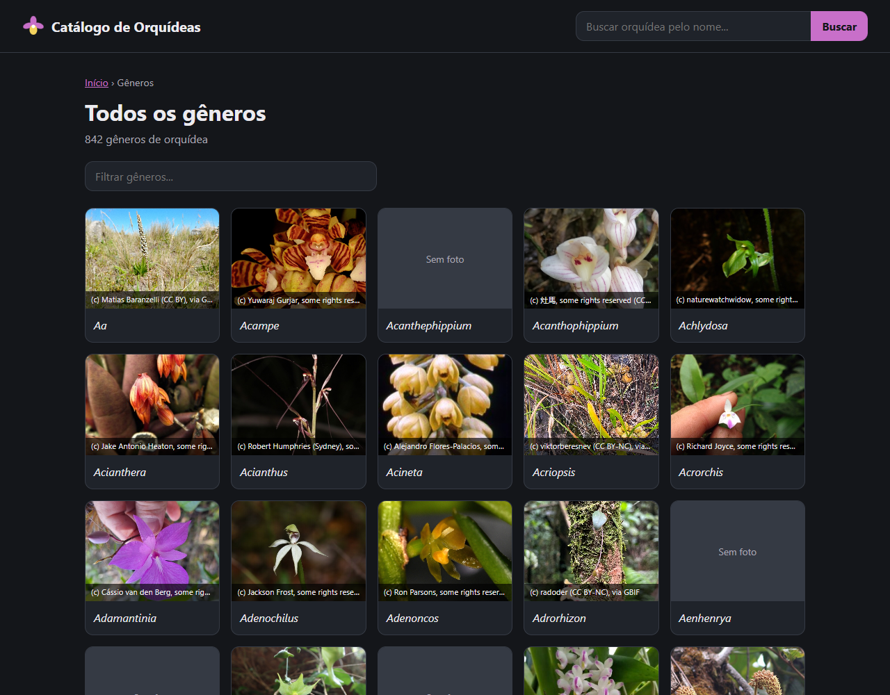

# Catálogo de Orquídeas

Site pra explorar orquídeas por **gênero → espécie → variedade**, com foto e busca pelo nome científico.
A ideia veio do meu pai: ele queria um jeito de quem não entende do assunto
descobrir quais tipos existem e ir navegando.

**No ar:** https://catalogo-orquideas.vercel.app


## O que dá pra fazer

- Começar por um dos 8 gêneros em destaque (Cattleya, Cymbidium, Dendrobium, Catasetum, Phalaenopsis,
  Vanda, Epidendrum e Maxillaria) ou abrir a lista com **todos os 842 gêneros** de orquídea.
- Ver todas as espécies aceitas de um gênero, filtrar pelo nome e carregar de 24 em 24.
- Abrir a ficha de uma espécie, com foto, quem a descreveu e as variedades.
- Buscar qualquer orquídea pelo nome, direto do cabeçalho.



## Páginas

| Endereço | O que mostra |
|---|---|
| `/` | gêneros em destaque |
| `/generos` | todos os gêneros, com filtro |
| `/genero/:id` | espécies de um gênero, com filtro |
| `/especie/:id` | ficha da espécie ou da variedade |
| `/busca?q=` | resultado da busca |

## Como funciona

- **Dados:** [GBIF](https://www.gbif.org), base internacional de biodiversidade. A API devolve a mesma
  planta repetida e marcações de "duvidosa"; o site limpa isso antes de mostrar (`src/utils/limparTaxons.ts`).
  Ela também entrega no máximo 1000 itens por pedido, então listas grandes (como os 1859 filhos do
  Dendrobium) são buscadas página por página (`src/services/gbif.ts`).
- **Fotos:** primeiro do [iNaturalist](https://www.inaturalist.org); se ele não tiver, das observações do GBIF.
  Só entram fotos com licença Creative Commons, sempre com o crédito do autor. Os pedidos de foto passam
  por uma fila (no máximo 4 por vez) e ficam guardados em memória (`src/services/fotos.ts`).
- Nenhuma das duas APIs pede chave, então o site é só front-end.

## Próximos passos

- Nome popular em português, pra dar pra buscar "orquídea-borboleta" e não só "Phalaenopsis".
- Fotos escolhidas à mão pras espécies que ainda aparecem "Sem foto".

## Tecnologias

React 19 · TypeScript · Vite · React Router 7 · CSS puro · Vitest · Vercel

## Rodar na sua máquina

```bash
npm install
npm run dev        # http://localhost:5173
npx vitest run     # testes
```
