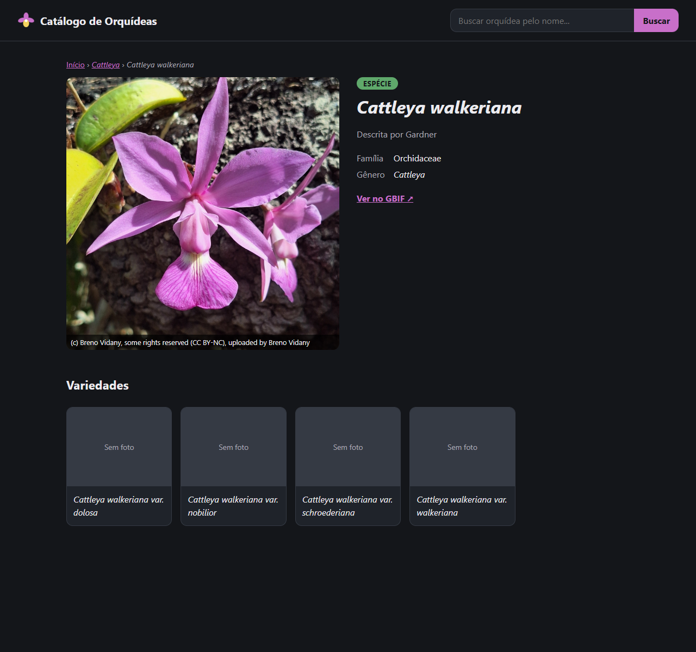

# Catálogo de Orquídeas

Site pra explorar orquídeas por **gênero → espécie → variedade**, com foto e busca pelo nome científico.
A ideia veio do meu pai: ele queria um jeito de quem não entende do assunto
descobrir quais tipos existem e ir navegando.



## O que dá pra fazer

- Escolher um gênero (Cattleya, Cymbidium, Dendrobium, Catasetum) e ver todas as espécies aceitas dele.
- Filtrar as espécies pelo nome e carregar de 24 em 24.
- Abrir a ficha de uma espécie, com foto, quem a descreveu e as variedades.
- Buscar qualquer orquídea pelo nome.

## Como funciona

- **Dados:** [GBIF](https://www.gbif.org), base internacional de biodiversidade. A API devolve a mesma
  planta repetida e marcações de "duvidosa"; o site limpa isso antes de mostrar (`src/utils/limparTaxons.ts`).
- **Fotos:** [iNaturalist](https://www.inaturalist.org), só as que têm licença Creative Commons, sempre
  com o crédito do autor.
- Nenhuma das duas APIs pede chave, então o site é só front-end.

## Tecnologias

React 19 · TypeScript · Vite · React Router 7 · CSS puro · Vitest · Vercel

## Rodar na sua máquina

```bash
npm install
npm run dev        # http://localhost:5173
npx vitest run     # testes
```
